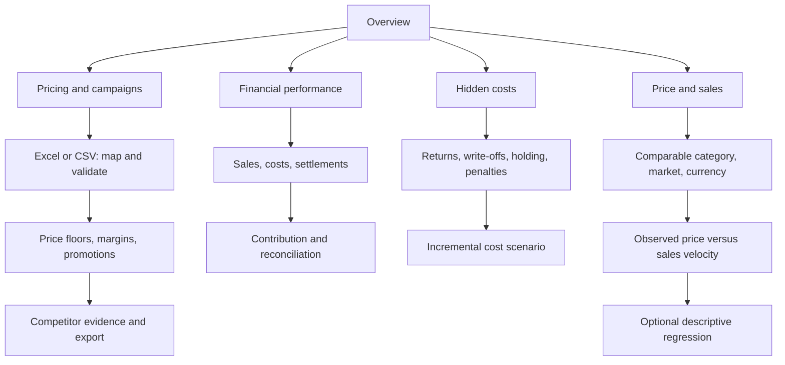

# MarketPrice — general seller workspace

Updated 2026-11-05. This direction supersedes a Digikala-only product scope. Digikala remains an adapter, not the business model.

## Site map

## Implemented in this local iteration

- Five bilingual workspaces with persistent language/navigation preferences.
- Navy/blue gradient hero, quiet blue-gray background, numbered action cards, contextual labels, restrained entrance/shape motion and reduced-motion support.
- Sidebar workspace navigation; long introductory/help content collapsed. Important calculation limitations remain next to relevant workflows.
- General financial entry point; Digikala invoice importer remains a collapsed optional adapter.
- Hidden-cost scenario: expected returns × (reverse logistics + unrecoverable value), plus total monthly stock holding cost × months, plus period penalties; per-dispatched-unit allocation and downloadable scenario.
- Optional OLS descriptive fit on observed price vs daily units within the existing comparable cohort. Export includes fitted evidence. No causal or demand prediction claim.

## Accounting contract

Do not label contribution as universal net profit. Net profit requires a complete period, sales and refunds, COGS, marketplace fees, reverse logistics, inventory loss, overhead allocation and applicable taxes. Display completeness and allocation assumptions. A forecast return allowance and a recorded return expense must not be counted twice.

Fee rules must carry category/channel, effective dates, currency, charge basis (unit/order/shipment/period), rate, floor/cap, rounding, tax basis and source. Unknown rules stay unknown. Never infer a permanent fee schedule from one statement.

The hidden-cost module is currently a standalone incremental scenario, not automatic bookkeeping integration. All inputs use the selected currency; selecting a different label does not convert amounts.

## Next delivery gates, in order

1. **General workbook mapping:** reusable mapping of sales/refunds/expenses/inventory and dates; preview rejected rows; trace every result to input rows. Accept two different synthetic seller layouts without code changes.
2. **Management profit report:** separate gross profit, contribution and operating/net result; explicit overhead/tax completeness; recorded vs forecast cost separation. Reconcile a private seller period to their records with unexplained differences visible.
3. **Connected decisions:** feed confirmed cost scenarios into price floors and campaign limits without duplicate expenses; export before/after assumptions and a decision log. Test capped fees at boundary prices.
4. **Product portfolio:** retain descriptive X/Y chart; add inventory availability, promotion and time history before estimating price response. Cross-product correlation alone cannot establish price elasticity.
5. **Market collection adapter:** begin with seller-supplied evidence; then permission-compatible collection with variant/condition/delivered-price matching, timestamp, source and stale-evidence handling. Never alter prices automatically from unmatched offers.
6. **Pilot and release:** three sellers, two repeated reviews each. Measure preparation time, actionable mistakes, false flags and return usage. A paid pilot is stronger evidence than feature count. Publish only synthetic cases, reproducible tests and architectural decisions.

## Design source and limits

Reference: https://dribbble.com/phenomenonbranding . Use original interface composition inspired by product-dashboard hierarchy and geometric accents; no third-party assets copied. No claim that a Dribbble reference establishes SEO performance. Local Streamlit redesign uses the Sites local implementation workflow, not hosted Sites publication.

## Definition of a defensible CV result

A reproducible synthetic workbook → validation → traced calculation → scenario comparison → exported decision, with independent numerical examples, boundary tests, clear limitations and measured seller feedback. The contribution is financial correctness and a usable repeated workflow, not decorative charts or unsupported AI recommendations.
