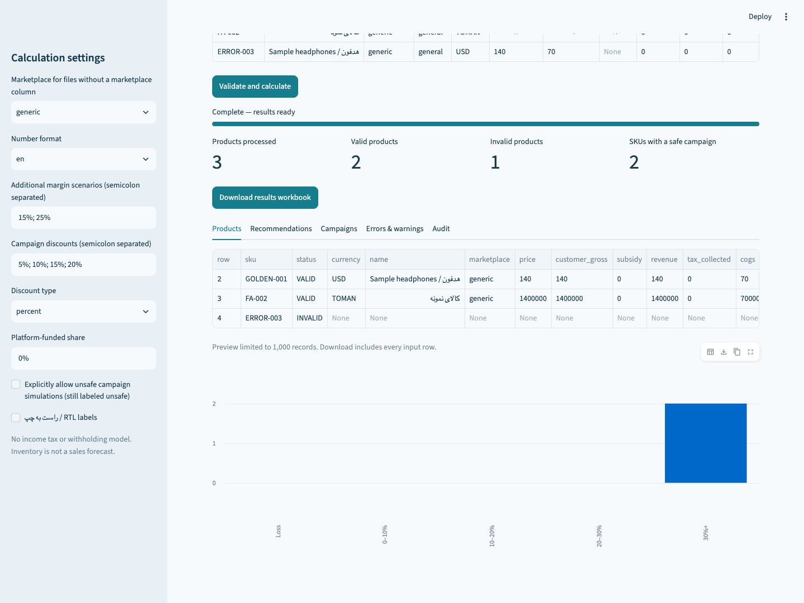

# MarketPrice 1.4

**1.4 workflow:** cost confidence, reusable setups, action lists, normalized actual-profit/settlement analysis, dated costs and approval manifests. [Development flow](DEVELOPMENT_FLOW.md) · [Operations guide](OPERATIONS.md) · [Experimental Excel companion](excel/README.md). Native marketplace adapters and the Excel button still require integration certification.

[Bilingual cost and pricing guide](COST_GUIDE.md): expanded optional costs, three margin scenarios, break-even, increase/decrease/keep analysis and configurable Black Friday, Christmas, Nowruz and Yalda offers. All campaign suggestions are constrained by entered costs, margins and discount limits.


## Flexible catalogs and local API

Start with purchase cost plus only the costs/taxes that apply, or process a company catalog with eleven cost fields. Set currency and margin once; incomplete products get individual errors. [Flexible catalog guide](FLEXIBLE_CATALOG.md) · [Pricing API and future marketplace adapters](API.md). Marketplace connections are not live yet.


**Understand your price floor before you discount.**

An AI-assisted portfolio project by [bhrdabpr](https://github.com/bhrdabpr), developed while studying Python. This repository is not represented as an approved CS50P submission. See [development credits](CREDITS.md).

MarketPrice is a local-first marketplace contribution calculator for CSV and Excel product data. It separates seller expenses from collected tax, computes explainable cost floors, and tests seller/platform/shared-funded campaigns. English and Persian names and numerals are supported; IRR and TOMAN remain distinct units.

This release has tested financial models and an end-to-end browser workflow. It is **not a universal tax engine or an officially certified marketplace settlement calculator**. Review [model limits](KNOWN_LIMITATIONS.md), [financial methodology](FINANCIAL_METHODOLOGY.md), and [actual QA evidence](FINAL_QA_REPORT.md) before operational use. Bundled marketplace profiles are examples, not official fee schedules. No public deployment is claimed.



## Run locally

Install Python 3.12+ (tested here with 3.13.3). On macOS, double-click `launch.command`; on Windows, use `launch.bat`; on Linux, run `./launch.sh`. First launch installs pinned dependencies into `.venv` and requires internet. Subsequent calculations work offline. The launcher starts a localhost server and opens your browser. Keep its terminal running; Ctrl+C stops it. macOS may require opening the script from Terminal if local security policy blocks double-click execution.

Manual equivalent:

```sh
python3 -m venv .venv
.venv/bin/python -m pip install -r requirements.lock
.venv/bin/python launcher.py
```

Windows manual commands use `.venv\Scripts\python.exe`. If installation fails, inspect the terminal error; the launcher does not silently continue. The macOS launcher execution was tested with an existing isolated environment; fresh dependency bootstrap and native double-click behavior on every OS are not claimed tested.

## Use it

1. Download the sample template or open `samples/sample_input.xlsx`.
2. Replace example values with verified per-product costs and rates. Enter `0` explicitly for confirmed no-cost items; blanks remain unknown. Store SKU identifiers as text.
3. Upload `.xlsx` or UTF-8 `.csv`. Choose a number locale and map columns if needed.
4. For a workbook with fewer cost types, enable **Configure applicable costs for this workbook** and select its applicable costs. Absent unselected cost columns are explicitly treated as inapplicable; blanks in present columns still cause individual product errors. Purchase cost and tax configuration remain required.
5. Select extra margin scenarios and campaign funding. Click **Validate and calculate**.
6. Review errors and warnings, then download all twelve result sheets.

The sample intentionally includes one missing-shipping row. A successful sample run gives two valid products, one invalid product, and **117.65 USD** for the golden 20% target. This is an example, not a recommended price for real merchandise.

## Capabilities

- Decimal financial ledger, progressive category commissions, four explicit fee bases.
- Inclusive/exclusive transaction tax, input tax credits and fee-tax recovery.
- Required-data errors with SKU/row/field/code/correction; no blank-to-zero coercion.
- Cost floors, multiple margin targets, competitor/current-price rules and price constraints.
- Percentage/fixed campaigns, shared funding, minimum-margin checks and explicit unsafe override.
- Versioned generic, custom, Digikala, Snapp Shop, Amazon, eBay, Shopify and WooCommerce profiles.
- Auditable Excel export, CLI, local UI, formula-injection protection and bounded uploads.

Margin means contribution divided by revenue excluding collected tax. No profit forecast is produced from unknown sales volumes. Market-optimal demand-based pricing is future work.

## CLI and deployment

```sh
.venv/bin/python -m marketprice.cli samples/sample_input.xlsx result.xlsx
.venv/bin/python -m marketprice.cli products.csv result.xlsx --locale fa --rules custom_profiles.json
```

For a browser deployment, use `docker compose up --build` after installing Docker. See [deployment instructions](DEPLOYMENT.md) for access control, resource settings and verification. Docker is prepared but was not built here because the environment has no Docker executable.

## Verification and performance

See [TESTING.md](TESTING.md) for reproducible unit, property, browser, lint, type and dependency checks, and `reports/` for their actual outputs. Benchmarks cover calculation **and XLSX export**, not only arithmetic: 1,000, 10,000 and 100,000 rows were measured on macOS ARM64/Python 3.13.3. Refer to the recorded JSON files for exact times and environment; no universal performance guarantee is implied.

## Documentation

[Architecture](ARCHITECTURE.md) · [Financial model](FINANCIAL_METHODOLOGY.md) · [Rules](MARKETPLACE_CONFIGURATION.md) · [Input fields](DATA_DICTIONARY.md) · [Persian guide](docs/راهنما.md) · [Research](RESEARCH_AND_BUILD_VS_FORK.md) · [Security](SECURITY.md) · [Roadmap](ROADMAP.md)

MIT-licensed original source. No upstream project code was copied. Contributions should include independent financial evidence and regression tests.

See [the five-minute test walkthrough](QUICK_TEST.md), including five-cost and ten-cost example workbooks.

## Quick verification

```sh
python -m pip install -r requirements-dev.lock
python -m pytest
ruff check .
mypy marketprice app.py
```

For a manual check, upload the sample, calculate and confirm two valid products, one missing-shipping error, and the 117.65 USD golden price. For applicable-cost validation, run `pytest tests/test_cost_scope.py -v`: both five-cost and ten-cost inputs preserve valid products while isolating blank commission errors.

Excel examples are generated locally rather than stored in this public repository. After installing dependencies, run `PYTHONPATH=. python scripts/generate_samples.py` from the project root. This creates the sample input/output and five/ten-cost workbooks from synthetic Python data. The sample CSV is also available directly.
